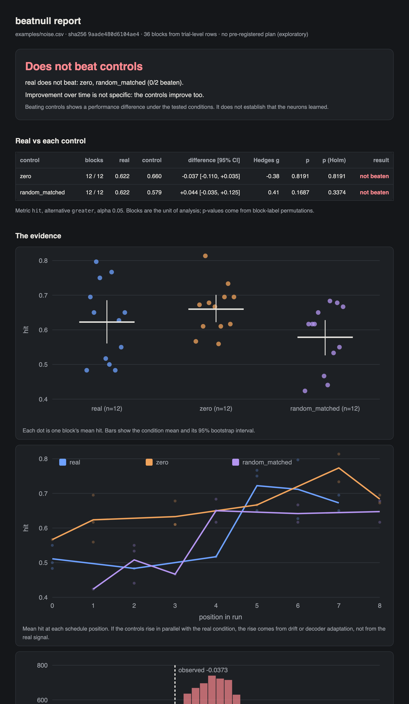

# beatnull

[](https://github.com/Arihanth-Mutha/beatnull/actions/workflows/ci.yml)


**Does your closed-loop result beat its controls?**

Closed-loop experiments (a living-neuron culture playing a game, a BCI decoder, an
adaptive stimulation protocol) produce learning curves that look like discovery and are
often something else: a decoder learning the task's statistics, drift across the run,
dropped frames that only happen on hard trials, or a thousand correlated trials tested as
if they were independent. beatnull takes a table of blocks or trials and tells you, in
one command, whether the result survives its controls. Every check is listed with the
reason behind it.



## The trap, in 30 seconds

```console
$ pip install beatnull
$ beatnull demo noise --report noise.html
wrote 2160 trials to noise.csv

The write-up version: real accuracy rose from 50% (first block) to 69% (last block),
Welch t-test p = 1.3e-05 on 477 trials.

■ DOES NOT BEAT CONTROLS — real does not beat: zero, random_matched (0/2 beaten).
  fail   Real vs controls       real does not beat: zero, random_matched (0/2 beaten).
  warn   Unit of analysis       A trial-level t-test would claim real beats random_matched
                                (p = 0.046, n = 1432 trials). With blocks as the unit: p = 0.337.
  fail   Improvement over time  real improves across the run (rho = +0.70, p = 0.0058), but
                                the controls improve just as much (rho = +0.61).
```

The simulated "culture" in that demo **ignores stimulation entirely**. Accuracy climbs
because the online decoder slowly learns that the target appears on the right 70% of the
time. That happens in every condition, including the one with no stimulation at all.
The naive analysis says "learning, p = 0.00001"; beatnull says the real condition does
not beat its controls and the improvement is not specific to it.

| Demo scenario | What is going on | beatnull verdict (30 seeds) | Naive first-vs-last test |
|---|---|---|---|
| `noise` | culture ignores stimulation; decoder learns the task bias | does not beat controls: **30/30** | "learning" at p < 0.05: 29/30 |
| `signal` | stimulated channels genuinely respond | beats controls: **29/30** | – |
| `dropout` | no signal, but stimulation artifacts drop frames on missed trials | unreliable (missing data): **30/30** | – |

Rates come from `beatnull demo` over seeds 1–30. `tests/test_checks.py` checks them
over seeds 1–10, so the demos are not cherry-picked.

## Install

```bash
pip install beatnull            # numpy + scipy, nothing else
# or from source
pip install -e ".[dev]" && pytest
```

## Use it

Give it a long-format table: one row per block, or one row per trial with a block id.
CSV, TSV, JSON and JSON Lines all work.

```csv
suite,block,position,condition,trial,hit
s1,s1-b01,0,real,0,1
s1,s1-b01,0,real,1,
s1,s1-b02,1,zero,0,0
```

```bash
beatnull check runs.csv --metric hit --group suite --report report.html --json result.json
```

```python
import beatnull as bn

ds = bn.load("runs.csv", metric="hit", group="suite")
result = bn.check(ds, real="real", controls=["zero", "random_matched"], alternative="greater")

result.verdict          # 'beats-controls' | 'does-not-beat-controls' | 'inconclusive' | 'unreliable'
result.improvement      # 'specific' | 'not-specific' | 'none' | 'unchecked'
bn.write_html(result, "report.html")   # one file, no network, light and dark mode
```

An empty cell, `nan`, `NA` or `null` is a **missing** measurement. It is never treated
as zero. A dropped frame is not a silent response.

### Pre-register, then check

```bash
# Before collecting data
beatnull plan --metric hit --group suite --real real --controls zero,random_matched \
  --alternative greater --alpha 0.05 --note "real beats both controls" -o plan.json
git add plan.json && git commit -m "Pre-register analysis"

# After
beatnull check runs.csv --plan plan.json --report report.html
```

The plan fixes the metric, conditions, direction, alpha and number of looks, and carries
its own SHA-256. If the plan is edited after freezing, the result is reported as
**unreliable**. The hash proves the plan has not changed. Committing or timestamping it
proves *when* it was written.

### Use it as a CI gate

| exit code | meaning |
|---|---|
| 0 | beats every control |
| 1 | does not beat controls, or the comparison is unreliable |
| 2 | inconclusive: the design cannot reach significance |
| 3 | bad input |

## What it checks

| Check | Question | How |
|---|---|---|
| **Real vs controls** | Does real beat *every* control? | Permutation test on block means (exact when ≤ 20,000 relabellings, otherwise 10,000 sampled), stratified within suites or cultures, Holm-corrected across controls; cluster-bootstrap 95% CI and Hedges' g |
| **Resolution** | Can this design even reach significance? | Reports the smallest achievable p. Three blocks per condition can never reach p < 0.05 after correction, so the result is *inconclusive*, not negative |
| **Data integrity** | Does missing data differ between conditions, and does the conclusion depend on it? | Fisher's exact test on missing vs measured, then a worst-case sensitivity analysis: every missing value set to the least favourable measured value |
| **Unit of analysis** | What would a pseudoreplicated test have claimed? | Trial-level Welch t-test shown next to the block-level result |
| **Order effects** | Does performance drift across the run, and does the schedule confound it? | Spearman permutation test on condition-centred values against position; mean schedule position per condition |
| **Improvement over time** | Is the learning curve specific to the real condition? | Trend in real, trend in controls, and a permutation test of the slope difference (level-centred) |
| **Interim looks** | Did checking results early inflate false positives? | Simulates accumulating null data to find the actual false positive rate and a constant (Pocock-type) per-look threshold |
| **Pre-registration** | Was the analysis fixed in advance, and is the plan intact? | Canonical-JSON SHA-256 |

```console
$ beatnull looks --max-looks 5 --alternative two-sided
looks   false positive rate  per-look alpha
    1                  5.0%          0.0500
    2                  8.3%          0.0291
    3                 10.8%          0.0218
    4                 12.6%          0.0182
    5                 14.2%          0.0155
```

Pocock's published per-look thresholds are 0.0294, 0.0221, 0.0182 and 0.0158. The
simulation recovers them to within its Monte Carlo error, and a test pins the 5-look value.

## Principles

- **The block is the unit.** Trials inside a block share a culture state, a decoder state
  and a stretch of time.
- **Resampling, not distributional assumptions.** Every p-value comes from relabelling
  blocks, and the report shows the null distribution it came from.
- **Missing is not zero.** Missing data is counted, compared across conditions and
  stress-tested, never imputed.
- **Every control must be beaten.** Beating "zero stimulation" but not "random matched
  stimulation" means the stimulation helps, not its content.
- **No verdicts about biology.** Every report says: *"Beating controls shows a performance
  difference under the tested conditions. It does not establish that the neurons learned."*

The statistics are in [`docs/method.md`](docs/method.md).

## Validation

`pytest` runs 47 tests, including:

- exact permutation p-values against hand-computed values; Holm against reference values
- **false positive rate under the null stays at the nominal 5%** (600 simulated experiments)
- Pocock boundary against the published value
- order confounds, unbalanced schedules, every-control-must-be-beaten, too-small designs
- a pre-registered plan edited after freezing turns the verdict to *unreliable*
- the CLI's exit codes and a report with no remote assets

## Prior art

None of the statistics here is new. beatnull packages established methods for one
setting: closed-loop experiments that run a real condition against zero and
random-matched controls in blocks.

| Idea | Where it comes from | What beatnull does with it |
|---|---|---|
| Permutation tests | [`scipy.stats.permutation_test`](https://docs.scipy.org/doc/scipy/reference/generated/scipy.stats.permutation_test.html) and many other packages | Blocks as the default unit, exact enumeration where feasible, and the smallest achievable p reported |
| Shuffling only within a dependence structure | [Winkler et al., *NeuroImage* 2015](https://doi.org/10.1016/j.neuroimage.2015.05.092), multi-level block permutation (implemented in their PALM toolbox) | Stratification by suite or culture |
| Pseudoreplication | [Lazic, *BMC Neuroscience* 2010](https://doi.org/10.1186/1471-2202-11-5) | Trial-level and block-level p shown side by side |
| Interim looks | [Pocock, *Biometrika* 1977](https://doi.org/10.1093/biomet/64.2.191); group-sequential design is standard in clinical trials | A simulated per-look threshold, checked against Pocock's published values |
| Worst-case missing data | Partial-identification bounds in the spirit of Manski (1990) | The comparison re-run with every missing value set against the claim |
| Pre-registration | [OSF Registries](https://osf.io/registries), [AsPredicted](https://aspredicted.org) | A local plan file whose hash makes edits visible. It does not replace a public registry |

Why it is needed: the DishBrain study ([Kagan et al., *Neuron* 2022](https://doi.org/10.1016/j.neuron.2022.09.001))
reported cultured neurons learning to play Pong, and a letter from
[Balci et al., *Neuron* 2023](https://doi.org/10.1016/j.neuron.2023.02.009) challenged its
claims of emergent intelligence and sentience. I didn't find a tool that runs these checks
together on closed-loop data. If you know of one, please open an issue.

## Context

I built beatnull alongside wetloop, a
development platform for living-neuron computers. wetloop's counterbalanced suites (real,
zero and random-matched conditions in Latin-square order) produce exactly this kind of
table. beatnull stands alone, with no dependency on wetloop or on any hardware SDK, and
works for any closed-loop or A/B-style experiment with blocks.

## Limitations

- Two-condition contrasts only (real vs each control). No mixed models and no
  multi-factor designs yet.
- The worst-case sensitivity analysis bounds missing values by the observed range, which
  is natural for bounded metrics (hit rates) and conservative for unbounded ones.
- The schedule-imbalance threshold (10% of the run) is a heuristic and is reported as one.
- A pre-registration hash detects edits; it cannot prove when the plan was written.

## License

Apache-2.0
